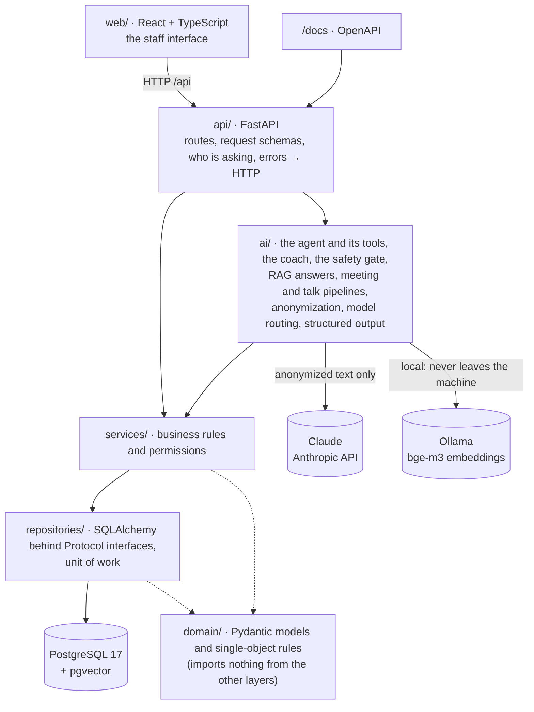

# Pacer

[](https://github.com/itayerenreich/pacer/actions/workflows/tests.yml)

**An AI assistant for the staff of a pre-military academy (מכינה קדם-צבאית), built so that privacy, safety and
quality are enforced in code and measured, not promised in a prompt.**

Counselors and a manager track trainees, the goals they set together, attendance, tasks and personal talks.
On top of that data sit AI features: staff meetings become proposed tasks, talk notes become proposed goal
updates, a **coach** gives practical advice about a specific trainee, and an **agent** answers any staff
question by deciding for itself what to look up. A web interface in Hebrew, right to left, puts it all in
one place.

| | |
|---|---|
| **Backend** | Python 3.12, FastAPI, PostgreSQL 17 + pgvector, SQLAlchemy 2, Alembic, 55 endpoints |
| **AI** | Claude (Haiku, Sonnet) through LiteLLM, local embeddings with Ollama, RAG, a tool-using agent |
| **Frontend** | React 18 + TypeScript + Vite, five screens, Hebrew right to left, dark mode, phone layout |
| **Quality** | about 945 tests (in-memory fakes and real PostgreSQL), ruff, mypy, CI on every pull request |
| **Measured** | six versioned evaluation sets, an LLM judge, a commercial vs open model comparison |

> **Status:** built and tested through stage 6 (see [Status](#status)). Before real users it needs real
> sign-in, deployment and a privacy review: today it runs on invented demo data only.

**About me:** I'm Itay Erenreich, a computer science and psychology student. Before my degree I was a
counselor and a branch manager at a pre-military academy, and saw firsthand the need Pacer is built for.

---

## Contents

- [What it does](#what-it-does)
- [Principles](#principles)
- [Architecture](#architecture)
- [Technologies and tools](#technologies-and-tools)
- [The AI features, and how each is checked](#the-ai-features-and-how-each-is-checked)
- [Measured results](#measured-results)
- [Run it](#run-it)
- [Tests](#tests)
- [Project layout](#project-layout)
- [Status](#status)

## What it does

| For | What |
|---|---|
| **Counselors** | Their trainees' goals and progress, approved notes on what worked and what did not, attendance per session, tasks with deadlines, and an assistant to ask anything ("how do I help Nadav take part in the group talks?") |
| **The manager** | Everything above for the whole academy, plus approvals (opening a personal file, sending a trainee home), the weekly schedule, staff meetings turned into tasks, and an overview of attendance by group |
| **Both** | A fixed procedure the moment a question suggests an exceptional incident (self-harm, violence, abuse): no AI advice, people and phone numbers instead |

The AI sits **above** the data, never instead of it: it proposes, and a person approves every item before
anything is written.

## Principles

These decide most of the design, and each is enforced somewhere specific in the code:

1. **Personal data does not reach a cloud model by name.** Names become tokens (`[TRAINEE_7]`) in code,
   before any call; the pipelines accept only an `AnonymizedText`, a type only the anonymizer can create; a
   second, independent check runs before anything is sent; and the model router refuses to route personal
   data to a model that does not run locally, failing closed.
2. **Health information is never sent and never kept.** Sentences about health are removed before sending,
   AI answers are filtered again, and there is no field anywhere that could store a diagnosis.
3. **Who may not see a record gets 404**, the same message as a record that does not exist, so ids cannot
   be probed. The rule lives in the services, so the API, the coach and the agent all obey the same one.
4. **The AI proposes, a person decides.** Every task, note and progress update from a model waits for
   approval, and anything a model's answer cannot back (an unknown person, a passage never sent) is removed
   and reported, never guessed.
5. **Safety is code first, model second.** A phrase list catches risk in code; a model is a second net that
   can only *add* a referral, never remove one.
6. **Measured, not assumed.** A prompt or model change is checked against a versioned answer key.

## Architecture



Each layer imports only the ones below it, and `domain/` imports nothing. Some decisions behind it:

- **Domain models and database rows are separate classes.** Pydantic holds the rules, SQLAlchemy describes
  storage, and a repository translates, so the domain never depends on the database.
- **Repositories behind `Protocol` interfaces.** Services ask for a `TraineeRepo`, not for SQLAlchemy, so
  the fast tests run the same services on in-memory fakes.
- **Unit of Work.** Repositories only flush; one transaction per request commits or rolls back together,
  and the API commits *before* it answers, so a failed save is never reported as success.
- **No model call inside a database transaction.** An AI pipeline reads in a short transaction, calls the
  model with none open, then writes in another one that locks the row and checks again. Tests assert that
  no transaction is open during any model call.
- **Updates build new validated objects** (`goal.with_progress(60)`), and approvals are a state machine.
- **Prompts are versioned files** (`prompts/<name>/vN.md`); a used version is never edited, a change is a
  new version, and every call logs which version it used.

## Technologies and tools

What each one is, why it is here, and where to find it.

### Language and tooling

| Tool | What it is | Why, and where |
|---|---|---|
| **Python 3.12** | The language of the backend | Type hints throughout, including the new generic syntax (`def found[T](...)`). `src/pacer/` |
| **uv** | A fast Python package and project manager (Astral) | One tool for the virtual environment, dependencies and running commands; `uv.lock` pins every version, and CI installs exactly the lock (`uv sync --locked`) |
| **ruff** | A linter written in Rust | Catches bugs and style problems in seconds; runs in CI |
| **mypy** | A static type checker | With the Pydantic plugin; all of `src/` type-checks with no errors |

### The web API

| Tool | What it is | Why, and where |
|---|---|---|
| **FastAPI** | A Python web framework built on type hints | Request validation, dependency injection (`Depends`) and the interactive `/docs` come from the types. `api/` |
| **Pydantic v2** | Data validation with Python types | The domain models and their rules, request bodies, and validating every model answer (structured output). `domain/`, `api/schemas.py` |
| **pydantic-settings** | Settings read from the environment and `.env` | Secrets as `SecretStr`, never printed; `.env` is never in Git. `config.py` |
| **Uvicorn** | An ASGI server | Runs the FastAPI app, with `--reload` in development |
| **OpenAPI** | A machine-readable description of the API | Generated by FastAPI; `/docs` lets you try every endpoint |

### Data

| Tool | What it is | Why, and where |
|---|---|---|
| **PostgreSQL 17** | The relational database | Transactions, constraints (`CHECK`, `UNIQUE`), row locks (`SELECT ... FOR UPDATE`), time zones done right |
| **pgvector** | A PostgreSQL extension for vector search | The library's embeddings live next to the rest of the data, in the same transactions: no second database to keep in sync (chosen over ChromaDB) |
| **SQLAlchemy 2** | The ORM and SQL toolkit | Typed table classes (`Mapped[...]`), and SQL that stays readable; `INSERT ... ON CONFLICT` for attendance. `repositories/` |
| **psycopg 3** | The PostgreSQL driver | The modern driver SQLAlchemy talks through |
| **Alembic** | Database migrations | Every schema change is a reviewed, versioned migration (10 so far); the integration tests run them too. `migrations/` |
| **python-docx, pypdf** | Reading Word and PDF files | Importing the academy's library texts. `library/` |

### AI

| Tool | What it is | Why, and where |
|---|---|---|
| **Claude** (Anthropic) | Large language models | **Haiku** answers (fast and cheap), **Sonnet** judges in the evaluation (stronger than what it grades). Chosen per task by measurement |
| **LiteLLM** | One interface to many model providers | Claude and local models through the same call, including tool calling for the agent; pinned to an exact version. Wrapped in our own `LLMClient` (the adapter pattern), so the rest of the code never imports it. `ai/llm_client.py` |
| **Ollama** | Runs open models on your own computer | The embedding model runs locally, so library search never sends text out; also used to compare an open model (gemma3:4b) with Claude |
| **bge-m3** | A multilingual embedding model | Turns text into vectors for search by meaning; chosen over qwen3-embedding by measurement on Hebrew (7 of 8 vs 2 of 8 at rank 1) |
| **RAG** (retrieval-augmented generation) | Answering from retrieved passages | Answers cite the passage each claim rests on; with no relevant passage, no model is asked. `ai/library.py`, `ai/answer.py` |
| **Tool calling** | A model asks for functions; our code runs them | The agent's seven read-only tools, each a Pydantic model whose JSON Schema is what the model sees. `ai/tools.py`, `ai/agent.py` |
| **LLM-as-judge** | A model grading another model's answer against a checklist | The evaluation's second check, where code cannot decide. `evaluation/judge.py` |

### Frontend

| Tool | What it is | Why, and where |
|---|---|---|
| **React 18** | A UI library of components | Five screens, with state kept where it belongs (the conversation lives in the page, never on the server). `web/src/` |
| **TypeScript** | JavaScript with static types | The API's shapes are typed once (`web/src/api.ts`), so a mismatch fails the build, not the user |
| **Vite** | A build tool and dev server | Hot reload in development, and it forwards `/api` to the backend, so no CORS is needed |
| **CSS** (no UI kit) | Plain CSS with design tokens | Right to left, light and dark, a phone layout; one shared look across the screens |

### Testing, delivery and infrastructure

| Tool | What it is | Why, and where |
|---|---|---|
| **pytest** | The Python test framework | Fixtures, parametrized cases, markers for integration and live-model tests. `tests/` |
| **testcontainers** | Throwaway Docker containers for tests | Each run starts a real PostgreSQL 17 with pgvector, runs the migrations, and deletes it |
| **Fakes** | In-memory repositories and a fake model | Fast tests of the real services; the fake model records what it was sent, so a test can prove that no name reached a cloud model |
| **Docker, Docker Compose** | Containers | PostgreSQL in development; the whole app as one image (Node builds the interface, Python serves it), with migrations on start. `Dockerfile`, `compose.yaml` |
| **GitHub Actions** | CI | On every pull request: ruff, mypy, the full test suite with a real database, and a build of the interface. `.github/workflows/tests.yml` |
| **Git workflow** | Feature branches and pull requests | Every change goes through a PR to `main`; larger changes also get a review by an independent agent that did not see them being built |

## The AI features, and how each is checked

### Staff meetings and personal talks
The text of a meeting becomes a summary and proposed tasks for named staff; a counselor's notes from a
talk become goal-progress proposals and notes worth remembering. Names are anonymized and health sentences
removed before Claude sees anything. The answer is validated in code against the database (is the owner a
staff member who was there? is it this trainee's goal?), and the manager or counselor approves each item.
(`ai/meeting_pipeline.py`, `ai/talk_pipeline.py`)

### The knowledge library (RAG)
Staff ask a question and get an answer **only from the academy's library**, every claim citing its passage.
Texts are cleaned, chunked and embedded locally (bge-m3), and searched in pgvector. Citations are built from
our own metadata, never by the model; a claim with no passage behind it is dropped and reported; and below
a relevance floor (chosen by measurement), no model is asked at all. (`POST /library/ask`)

### The counselor coach, and its safety gate
"How do I help Nadav take part in the group talks?" gets steps built on Nadav's approved record: his goals,
his attendance, and notes on what **worked** with him and what did not. (`POST /coach/ask`)

```
question ─► phrase list (code) ─► permissions (404) ─► Claude screen ──► exceptional incident? the procedure
         ─► his record, built in code ─► health out ─► anonymized ─► library passages ─► Claude
         ─► validation: a step counts as grounded only if it cites a passage that was really sent
```

### The agent
Everything above is a fixed pipeline: the code decides the steps. The agent is different: **the model
decides which tools to call, and our code runs them.** Asked "how do I deal with Nadav Nahum, who isn't
meeting his goals?", it looks up his attendance and his record, and asks the coach. (`POST /agent/chat`)

- **The model only asks.** Seven read-only tools over the existing services. None has a "who is asking"
  parameter: the actor is bound in code, so a trainee of another group is "not found", exactly like a 404.
  A wrong argument is an error the model reads and corrects, never a crash.
- **One token space per conversation.** A session keeps every token consistent across the message, the
  history and every tool result, and defuses any token typed into a message, even with an invisible
  character inside it.
- **Limits:** 6 rounds, 10 tool calls and $0.25 per message (an unknown cost counts against the cap); at a
  limit, one last round answers in text from what was found.
- **Nothing about the conversation is stored.** The history comes from the page and is treated as untrusted
  input: checked and anonymized again every time.
- **The interface shows the route it took:** each tool call is a waypoint under the answer, with counts,
  never content.

### Schedule, attendance and tasks
A weekly template and the weeks made from it (two tables, so changing a week never rewrites the template);
attendance per session as present, absent or excused, with rate = present / (present + absent); and tasks
from meetings or written by hand, with deadlines and an optional trainee. There is no free-text "reason"
field anywhere: "he was at the doctor" is health data.

## Measured results

Every number below comes from a versioned answer key in `evals/` and `python -m pacer.evaluation`.

**The library** (Claude Haiku answering, Claude Sonnet judging; `library@v1`, 23 questions):

| | with the library | without |
|---|---|---|
| claims supported by the passage they cite | 98% | - |
| a right source retrieved and cited | 94% | - |
| checklist items met | 92% | 74% |

**A commercial model or an open one on this laptop?** The same cases with Claude Haiku and gemma3:4b (open,
through Ollama, on a 16 GB laptop with no GPU):

| | Claude Haiku | gemma3:4b, local |
|---|---|---|
| claims supported by their passage | 95% | 50% |
| talk summaries: goal progress in the expected range | 100% | 0% |
| seconds per answer | 17 | 109 |

The local model kept every name on the computer, and failed the task. So Claude is used, with privacy kept
in code instead.

**The safety gate** (`safety-heldout-v1`: 60 risk sentences written to break it, which nobody tuned it on):
the phrase list alone found **30 of 60**, because subtle risk is described as a scene ("stood on the roof at
night"). With Claude as a second net: **60 of 60**, with no false alarm added.

**The coach** (`coach@v1`, 9 cases, each judged with and without the trainee's record):

| Claude Haiku as the coach | |
|---|---|
| the right outcome (advice, or the procedure) | 9 / 9 |
| items about THIS trainee met, **with** their record | **95%** |
| the same items, **without** it | 48% |
| no diagnosis, no medical labels, no treatment advice | 100% |
| steps grounded in the library | 0% |

Claude Sonnet scored the same at 16 times the cost, so Haiku stays. **0% grounded is honest, not a bug:**
the demo library holds five classical texts on education, and no passage was close enough to these
practical questions, so every step is marked general advice.

**The agent** (`agent@v2`, 19 cases) is checked in code for the outcome, the tools it had to call and must
not call, that every call was about the right trainee, and the answer's text, with a judge for the
checklists. Only the agent's model changes between runs (`--model`), so Haiku and Sonnet are compared on
choosing tools.

> **Read these numbers for what they are:** small, invented sets on a deliberately tiny library, built to
> test the mechanism. What they show is the method: every change to a prompt, a model or a source can be
> measured instead of guessed.

## Run it

Needs [uv](https://docs.astral.sh/uv/), Docker and [Node](https://nodejs.org) 22. The AI features need
`ANTHROPIC_API_KEY` in `.env`, and the library needs [Ollama](https://ollama.com) with `ollama pull bge-m3`.

```bash
cp .env.example .env                          # then set a password (and the API key for the AI features)
docker compose up -d                          # PostgreSQL
uv run alembic upgrade head                   # the tables
uv run python -m pacer.demo                   # the demo academy: 35 trainees, 4 counselors, a manager
uv run uvicorn pacer.api.app:app --reload     # the API: http://127.0.0.1:8000/docs
cd web && npm install && npm run dev          # the interface: http://localhost:5173
```

Sign in with a staff id (1 is the manager, 2 to 5 are counselors). This is a development stand-in for real
authentication (the `X-Staff-Id` header), isolated in one function so it can be replaced without touching
the endpoints. Or run everything in one container:

```bash
docker compose --profile app up -d --build                      # http://localhost:8000
docker compose exec app uv run --no-sync python -m pacer.demo   # the demo academy, once
```

The library and the evaluation:

```bash
uv run python -m pacer.library import data/library/classics.docx --manifest library/classics.json
uv run python -m pacer.library index --model bge-m3
uv run python -m pacer.evaluation agent --out data/agent-haiku.md           # about $0.30
uv run python -m pacer.evaluation coach --out data/coach-haiku.md
uv run python -m pacer.evaluation safety --send --out data/safety.md
```

The library's files stay out of Git (`data/`). Reports are Markdown written right to left: open them in
VS Code with Ctrl+Shift+V.

## Tests

```bash
uv run pytest                        # everything (Docker must be running)
uv run pytest -m "not integration"   # fast tests only, no Docker, about 15 seconds
uv run pytest --run-llm -m llm       # against real models: a fraction of a cent, never in CI
cd web && npm run build              # the interface: type check and build
```

- **Fast tests** run the real services and the HTTP API against in-memory fakes, swapped in through
  dependency injection.
- **Integration tests** run the real chain against a throwaway PostgreSQL, the migrations included, and
  check what only a real database can: row locks under concurrent requests, constraints, time zones.
- **AI tests** use a scripted model that records what it was sent, so a test can prove that no known name
  reached a cloud model, and that no transaction was open during the call.
- **Mutation checks** for the protections that matter: each one is broken on purpose, and a test must fail.

## Project layout

```
src/pacer/
  domain/         Pydantic models and their rules: trainees, goals, approvals, meetings, tasks, schedule
  repositories/   SQLAlchemy tables, repositories, the unit of work
  services/       business rules and permissions (visibility.py: the 404 rule)
  ai/             llm_client, routing, anonymization, sensitive, safety, risk_screen, structured,
                  library, answer, coach, tools, agent, meeting_pipeline, talk_pipeline
  prompts/        versioned system prompts, one folder per task
  api/            the FastAPI app, routers, schemas, dependencies, errors; web.py also serves the interface
  library/        importing and chunking the library's texts
  evaluation/     the runner, the judge, the reports
  demo/           the demo academy, and command-line demos
  maintenance/    deleting records past the retention period
web/              the React + TypeScript interface
evals/            the answer keys (JSON)
migrations/       Alembic migrations
tests/            pytest: fakes, unit, API and integration tests
```

## Status

| Stage | Contents | State |
|---|---|---|
| 1. Data layer | domain models, PostgreSQL, migrations, repositories | done |
| 2. Logic and API | services, roles, approvals, REST API, demo data, CI | done |
| 3. AI core | LLM client, model routing, anonymization, the meeting and talk pipelines | done |
| 4. Knowledge and quality | a curated library, RAG with citations, evaluation sets, open vs commercial models | done |
| 5. Counselor coach | a two-layer safety gate, the trainee's approved record, advice grounded where it can be | done |
| 6. Assistant and UI | a tool-using agent, the staff interface, schedule, attendance and tasks, Docker | built; measuring the agent next |
| Before real users | real sign-in, deployment, backups, onboarding an academy, privacy review | planned |
